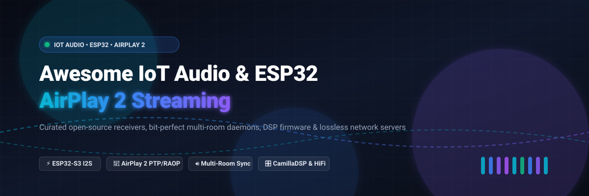

# Awesome-IOT-Audio-Esp32-Airplay-2-Streaming 🎵

  

  

### 🔊 Curated Hub for IoT Audio, ESP32 AirPlay 2, Multi-Room Network Streaming & Lossless Hi-Fi 🌟

*A high-performance directory of open-source ESP32 firmware, bit-perfect AirPlay 2 / RAOP receivers, multi-room synchronizers, audiophile Linux distributions, and lossless streaming daemons—benchmarked against commercial SaaS audio ecosystems.*

---

## 📑 Table of Contents

- [🌐 Sector Overview & Market Dynamics](#-sector-overview--market-dynamics)
- [☁️ SaaS/Hosted Platforms](#️-saashosted-platforms)
- [🛠️ Open-Source Equivalents & Tools](#️-open-source-equivalents--tools)
  - [⚡ ESP32 AirPlay 2, DSP & Embedded Microcontroller Audio](#-esp32-airplay-2-dsp--embedded-microcontroller-audio)
  - [📡 Open-Source AirPlay & AirPlay 2 Receivers](#-open-source-airplay--airplay-2-receivers)
  - [🔊 Multi-Room Audio & Open-Source Audiophile OS](#-multi-room-audio--open-source-audiophile-os)
  - [🎧 Open-Source Spotify Connect, Tidal & Streaming Daemons](#-open-source-spotify-connect-tidal--streaming-daemons)
  - [🎛️ Network Music Servers & Whole-Home Audio Orchestration](#️-network-music-servers--whole-home-audio-orchestration)
- [📊 Star History](#-star-history)
- [🤝 Contributing](#-contributing)
- [💖 Support](#-support)

---

## 🌐 Sector Overview & Market Dynamics

The global wireless and multi-room audio market is estimated at **$31 billion to $45 billion**, with long-term forecasts projecting expansion past **$80+ billion** (10–11.5% CAGR). The sector is **moderately to highly fragmented**: consumer discovery, casting protocols, and voice interfaces are heavily contested by ecosystem giants (Apple, Google, Spotify, Samsung/Harman), while dedicated audiophile streaming hardware and high-fidelity room sync remain distributed across specialized premium platforms (Sonos, Bluesound/BluOS, WiiM/Linkplay, Roon) and an active open-source ecosystem.

---

## ☁️ SaaS/Hosted Platforms

Commercial, cloud-authenticated audio streaming protocols, proprietary audiophile ecosystems, and subscription-based multi-room music platforms.

| Product / Platform | Company Scale (Revenue / Valuation) | Pricing (Starting Paid Tier) | Free Tier / Free Trial Limits | Description |
| :--- | :--- | :--- | :--- | :--- |
| **[Apple AirPlay 2 & HomeKit](https://apple.com)** | ~$3.5T Market Cap / ~$391B Annual Revenue | $99/year (Apple Developer Program for API/MFi protocol access) or $10.99/mo (Apple Music Individual) | No permanent free tier; 1-month free trial (30 days) with full catalog and AirPlay streaming access | Apple's proprietary wireless streaming protocol and cloud-synced multi-room audio standard for iOS, macOS, and certified speakers. |
| **[Spotify Connect](https://spotify.com)** | ~$120B Market Cap / ~$19.4B Annual Revenue | $11.99/month (Spotify Premium Individual) | Free forever plan available; limited to ad-supported playback, 6 track skips/hr, shuffle mode on mobile, and capped bitrates (~160 kbps) | Proprietary cloud-mediated streaming protocol allowing Spotify apps to hand off playback directly to network-connected speakers and IoT devices. |
| **[Sonos / WiiM / BluOS Ecosystems](https://sonos.com)** | ~$1.55B Annual Revenue (Sonos, NASDAQ: SONO) | Free app control included with hardware purchase (hardware starts at $99 for WiiM Mini, $179+ for Sonos) | Free forever app & ecosystem tier; requires ownership of compatible hardware devices | Commercial IoT wireless audio hardware/cloud platforms integrating AirPlay 2, Spotify Connect, and multi-room grouping. |
| **[TIDAL Connect](https://tidal.com)** | ~$300M Acquisition Valuation (Block Inc. subsidiary) | $10.99/month (TIDAL Individual) | No permanent free plan; 30-day free trial with full access to HiRes FLAC, Dolby Atmos, and TIDAL Connect casting | Commercial lossless audio casting technology streaming high-resolution FLAC/Dolby Atmos tracks directly from TIDAL's cloud to compatible hardware. |
| **[Plexamp (Plex Pass)](https://plex.tv)** | ~$60M+ Annual Revenue / $130M+ Venture Funding | $6.99/month (or $69.99/year, $749.99 Lifetime) | Free forever basic Plexamp tier; limited to basic local playback without Sonic Analysis, Guest DJs, Loudness Leveling, or offline downloads | Proprietary audiophile music player powered by Plex Media Server with cloud-assisted sonic analysis and loudness leveling. |
| **[Roon Labs (Roon & Roon ARC)](https://roon.app)** | Standalone subsidiary of Harman / Samsung Electronics ($300B+ parent corp) | $14.99/month (or $149.88/year billed annually) | No permanent free plan; 14-day free trial with unrestricted access to DSP engine, multi-room sync, and Roon ARC remote streaming | Commercial audiophile music management, RAAT multi-room streaming, and cloud-authenticated mobile streaming platform. |
| **[Volumio (MyVolumio Premium)](https://volumio.com)** | Bootstrapped European audio tech SME (~$3M–$5M est. revenue) | €6.49/month (or €59.99/year billed annually) | Free forever open-source DIY core OS; limited to local/NAS playback and basic Web Radio without native TIDAL/Qobuz integration or multi-room sync (15-day free trial for Premium) | Commercial tier and cloud relay service for Volumio offering multi-room sync, Tidal/Qobuz native integration, and remote access. |
| **[Audirvāna](https://audirvana.com)** | Independent boutique software developer (<$5M est. revenue) | $7.99/month (or $79.99/year for Audirvāna Studio) | No permanent free plan; 30-day free trial with unlimited features and up to 30 AudioScan analyses (no credit card required) | Proprietary high-resolution audio playback software featuring kernel-level optimization, UPnP/DLNA streaming, and cloud streaming integration. |

---

## 🛠️ Open-Source Equivalents & Tools

Free and open-source software (FOSS) ESP32 AirPlay 2 receivers, open-source AirPlay/Spotify daemons, bit-perfect Linux audio OS builds, and whole-home multi-room servers. Repositories in each section are sorted in descending order by GitHub_Stars.

### ⚡ ESP32 AirPlay 2, DSP & Embedded Microcontroller Audio

* **[ESP32-A2DP](https://github.com/pschatzmann/ESP32-A2DP)**  - Popular C++ Arduino/ESP-IDF library turning ESP32 boards into Bluetooth A2DP audio sinks and sources with I2S DAC output.
* **[arduino-audio-tools](https://github.com/pschatzmann/arduino-audio-tools)**  - Comprehensive C++ audio processing, streaming, codec, and DSP toolkit tailored for ESP32 and embedded microcontrollers.
* **[ESP-ADF](https://github.com/espressif/esp-adf)**  - Official Espressif Audio Development Framework for building audio applications on ESP32, ESP32-S2, and ESP32-S3 SoCs.
* **[Squeezelite-ESP32](https://github.com/sle118/squeezelite-esp32)**  - Feature-packed open-source ESP32 audio firmware supporting AirPlay, Spotify Connect, Bluetooth A2DP, Squeezebox/LMS, and I2S DACs.
* **[ESP32-audioI2S](https://github.com/schreibfaul1/ESP32-audioI2S)**  - High-performance ESP32 I2S audio library playing MP3, AAC, FLAC, and Web Radio streams with external PSRAM optimization.
* **[airplay-esp32](https://github.com/rbouteiller/airplay-esp32)**  - Complete AirPlay 2 receiver implementation for ESP32/ESP32-S3 microcontrollers with HomeKit pairing and I2S playback.
* **[esp32-airplay2-surround](https://github.com/kristian8606/esp32-airplay2-surround)**  - Synchronized AirPlay 2 surround sound receiver firmware running on low-cost ESP32-S3 boards.

### 📡 Open-Source AirPlay & AirPlay 2 Receivers

* **[Shairport Sync](https://github.com/mikebrady/shairport-sync)**  - The premier open-source AirPlay and AirPlay 2 audio receiver for Linux/FreeBSD with multi-room synchronization and ALAC/ALSA bit-perfect output.
* **[RPiPlay](https://github.com/FD-/RPiPlay)**  - Open-source AirPlay mirroring server and audio receiver with hardware video acceleration for Raspberry Pi.
* **[AirConnect](https://github.com/philippe44/AirConnect)**  - Cross-platform daemon that exposes Sonos, UPnP/DLNA, and Chromecast audio players as native AirPlay capabilities.
* **[OwnTone](https://github.com/owntone/owntone-server)**  - Open-source media server (formerly forked-daapd) streaming personal libraries, radio, and pipes simultaneously to AirPlay 1 & AirPlay 2 endpoints.
* **[UxPlay](https://github.com/antimof/UxPlay)**  - AirPlay mirroring and audio streamer server for Linux, macOS, and BSD running on top of GStreamer.
* **[NQPTP](https://github.com/mikebrady/nqptp)**  - Precision Timing Protocol (PTP) daemon tailored for Apple's timing variant to enable multi-room audio synchronization in AirPlay 2.

### 🔊 Multi-Room Audio & Open-Source Audiophile OS

* **[Snapcast](https://github.com/badaix/snapcast)**  - Synchronous multi-room client-server audio streaming platform delivering microsecond-accurate time-aligned playback across IoT nodes.
* **[moOde audio player](https://github.com/moode-player/moode)**  - Audiophile Linux OS for single board computers featuring built-in AirPlay, Spotify Connect, CamillaDSP, and high-res playback.
* **[Volumio Core](https://github.com/volumio/Volumio2)**  - Headless open-source music player operating system converting Raspberry Pi and x86 hardware into dedicated Hi-Fi network streamers.
* **[HiFiBerryOS](https://github.com/Hifiberry/hifiberry-os)**  - Dedicated Buildroot Linux distribution purpose-built for audio streamers with AirPlay, Bluetooth, Roon, and Spotify endpoints.
* **[CamillaDSP](https://github.com/HEnquist/camilladsp)**  - Lightning-fast IIR/FIR digital signal processing engine written in Rust for room acoustic correction, bi-amping, and active crossovers.

### 🎧 Open-Source Spotify Connect, Tidal & Streaming Daemons

* **[MediaMTX](https://github.com/bluenviron/mediamtx)**  - Zero-dependency, real-time media router and server supporting WebRTC, RTSP, RTMP, and low-latency audio/video routing.
* **[librespot](https://github.com/librespot-org/librespot)**  - Open-source client library and headless Spotify Connect player written in Rust that powers modern DIY IoT audio streamers.
* **[Raspotify](https://github.com/dtcooper/raspotify)**  - Easy-to-install Spotify Connect daemon for Debian, Ubuntu, and Raspberry Pi OS packaged with systemd integration.
* **[go-librespot](https://github.com/devgianlu/go-librespot)**  - Clean, standalone Golang Spotify Connect client supporting ALSA, PulseAudio, PipeWire, and MPRIS metadata control.

### 🎛️ Network Music Servers & Whole-Home Audio Orchestration

* **[Jellyfin](https://github.com/jellyfin/jellyfin)**  - Popular 100% free software media system providing bit-perfect music streaming, FLAC transcoding, and DLNA server functionality.
* **[Navidrome](https://github.com/navidrome/navidrome)**  - Modern, lightweight Subsonic-compatible music server and streamer written in Go for serving huge lossless audio collections.
* **[Mopidy](https://github.com/mopidy/mopidy)**  - Extensible Python music server that plays local files and streams from Spotify or SoundCloud directly to multi-room outputs.
* **[Music Assistant](https://github.com/music-assistant/server)**  - Whole-home music library orchestrator connecting Spotify, Tidal, Apple Music, and local files directly to AirPlay, Cast, and Snapcast players.
* **[MPD (Music Player Daemon)](https://github.com/MusicPlayerDaemon/MPD)**  - Minimalist, server-side audio player for streaming music over HTTP/RTP/ALSA, controllable via dozens of lightweight front-ends.
* **[Lyrion Music Server (LMS)](https://github.com/Logitech/slimserver)**  - Battle-tested multi-room audio server supporting Squeezelite ESP32 players, AirPlay bridges, and high-resolution DSD/FLAC streaming.

---

## 📊 Star History

---

## 🤝 Contributing

Contributions are warmly welcomed! Feel free to open a Pull Request to add more open-source ESP32 audio projects, AirPlay 2 receivers, audiophile Linux distributions, or multi-room streaming tools.

1. 🍴 Fork the repository.
2. 🌿 Create a new feature branch (`git checkout -b feature/awesome-audio-tool`).
3. 📝 Add your project under the appropriate category with its repository Stars_Badge and a clear description.
4. 🚀 Submit a Pull Request.

---

## 💖 Support

Thank you for exploring this curated collection of IoT audio, ESP32, and AirPlay 2 projects! If you find this repository helpful, please consider:

- ⭐ **Starring** the repository on GitHub
- 🍴 **Forking** and contributing your favorite audio tools
- 📢 **Sharing** this guide with fellow makers, audiophiles, and IoT engineers
- ☕ Supporting continued maintenance and development via the [GitHub Sponsors Dashboard](https://github.com/sponsors/ishandutta2007)

*Every bit of support helps keep open-source audio documentation accessible and up to date!* 🎶
